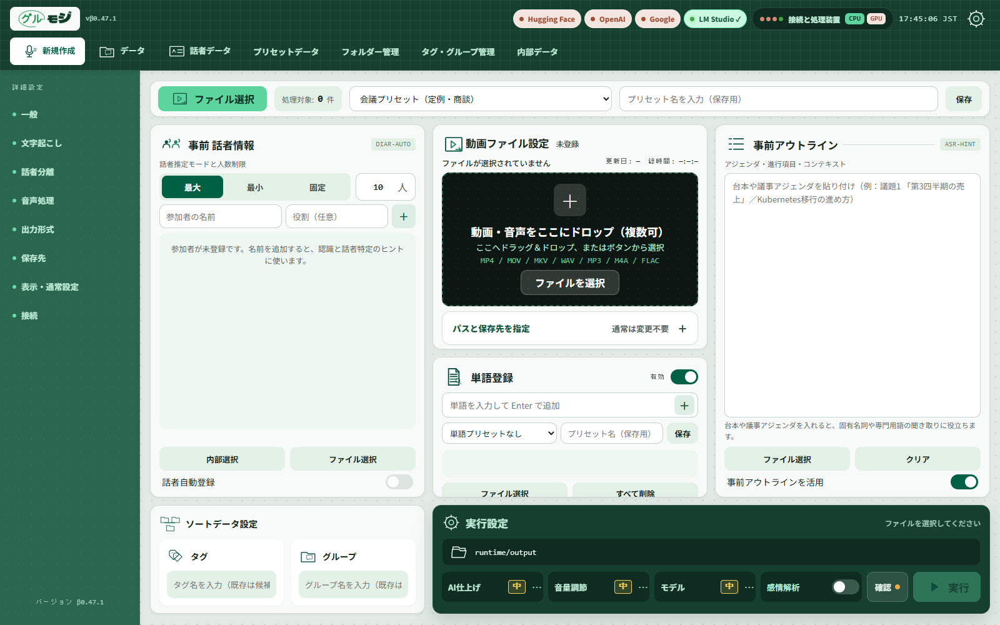
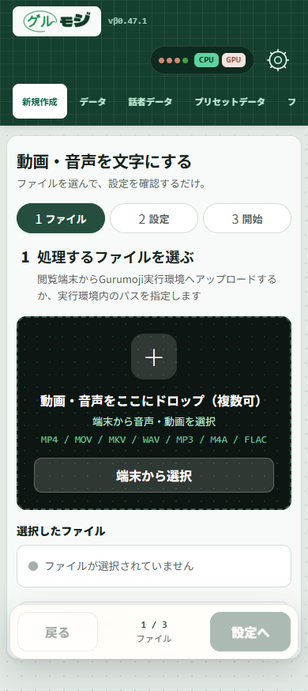

# Gurumoji（グルモジ）

<p align="center"></p>

**動画・音声を文字にして、話者ごとに確認・編集・保存するWebアプリです。**

会議やインタビューの録音を取り込み、文字起こしと話者分離を行います。結果を元の音声・動画と照合しながら編集し、TXT・JSON・SRTへ書き出せます。Windowsでは自分のPC上で、Google ColabではColabのランタイム上で利用できます。

バージョンはβ0.47.2です。認識結果やAIによる修正・話者名候補は、元の録音と照合して確認してください。

[配布版をダウンロード](https://github.com/krokharu/Gurumoji-public/archive/refs/heads/public/release.zip) · [利用開始ガイド](docs/GETTING_STARTED.md) · [Google Colabで開く](https://colab.research.google.com/github/krokharu/Gurumoji-public/blob/public%2Frelease/notebooks/Gurumoji_Colab.ipynb)

## 画面イメージ



公開版 β0.47.1 のPC画面です。録音・文字起こし・認証情報を登録していない一時環境で撮影しています。

<details>
<summary>スマートフォン幅の画面を見る</summary>



スマートフォンから実行中のアプリへアクセスした際の表示です。スマートフォン単体での音声モデル実行を示すものではありません。

</details>

## 主な機能

| 機能 | できること |
| --- | --- |
| 文字起こし・話者分離 | Whisper / WhisperXで録音を文字にし、話者ごとに発話を整理 |
| 確認・編集 | 元メディアを再生しながら本文・時刻・話者名を修正。長い会話は100発話ずつ表示し、全文を検索 |
| 書き出し | TXT・JSON・SRTで保存 |
| 話者・データ管理 | 話者台帳、属性、タグ、フォルダー、グループを管理 |
| 任意のAI仕上げ | 文章の修正、アウトライン作成、話者名候補、表記ゆれの確認 |
| 処理設定 | 参加者・議題の事前入力、単語登録、プリセットの保存 |
| バックアップ | 保存データのバックアップと復元 |

AI仕上げは接続先や認証情報の設定が必要な処理があります。基本の導入手順は以下を、追加モデルや細かい設定は [利用開始ガイド](docs/GETTING_STARTED.md) を参照してください。

## Windowsで始める

64 bit版Python 3.10〜3.13を使用します。初回の環境準備とモデル取得にはインターネット接続が必要です。GPUの利用可否は機器・モデル・設定によって異なります。

1. [配布版のZIP](https://github.com/krokharu/Gurumoji-public/archive/refs/heads/public/release.zip) を取得し、書き込みできるフォルダーへ展開します。
2. `setup_gui.bat` を開き、案内に従って環境を準備します。話者分離用のHugging Faceモデルについて、利用条件への同意とread tokenを設定します。
3. `run.bat` を開き、ブラウザーで `http://127.0.0.1:7860` にアクセスします。
4. 動画・音声を選び、条件を確認して文字起こしを開始します。完了後に結果を確認・編集し、保存します。

Gitを使う場合は、配布用の `public/release` ブランチを取得します。

```powershell
git clone --single-branch --branch public/release https://github.com/krokharu/Gurumoji-public.git
cd Gurumoji-public
```

起動に失敗する場合は、[トラブル対応](docs/GETTING_STARTED.md#起動できないとき) を確認してください。更新方法も [利用開始ガイド](docs/GETTING_STARTED.md#更新する) にまとめています。

## Google Colab / Linuxで使う

[Colabノートブック](https://colab.research.google.com/github/krokharu/Gurumoji-public/blob/public%2Frelease/notebooks/Gurumoji_Colab.ipynb) を開き、環境準備からWeb UIの起動まで順に実行します。GPU・認証・保存先を設定し、ノートブックの認証付きポート表示を使用してください。

Colabでは録音や処理データをGoogleのランタイムへ取り込みます。ランタイムやGPUの継続利用は保証されず、一時ファイルはランタイム終了で失われます。保持する結果は保存先を確認してください。

LinuxではPython環境と依存関係を準備して `bash scripts/run_cloud.sh` で起動します。詳しくは [フォルダー構成と環境変数](docs/PROJECT_LAYOUT.md) を参照してください。

## データの保存と外部通信

- 利用者データは既定で `runtime/`、APIキーなどの接続情報は `config/tokens.json` に保存します。配布コードには実利用者データや認証情報を含めていません。
- 初回導入・モデル取得では配布元へ接続します。外部AIによる仕上げ等を有効にすると、処理対象の文章や必要な文脈が選択した接続先へ送られます。
- 通常のバックアップには元の音声・動画や認証ファイルを含みません。必要な元メディア・書き出し結果・接続情報は別途保管してください。

保存先、AIへの送信、メディアを含むバックアップ、復元方法は [データと外部通信](docs/DATA_AND_PRIVACY.md) を参照してください。

## 公開版の提供範囲

この公開版は、文字起こし・編集・話者管理・保存を対象としています。会話分析・可視化、自律分析、スライド生成、音声感情分析、事前アンケートの集計、Obsidian連携、ObusSQL接続は提供していません。

画面に残る「感情解析」スイッチや「Coming Soon」の表示は、利用できる機能を示しません。β版のため、画面や機能は更新で変更されることがあります。

## 操作ガイド・問い合わせ

| 資料 | 内容 |
| --- | --- |
| [利用開始ガイド](docs/GETTING_STARTED.md) | 導入、起動、更新、追加モデル、トラブル対応 |
| [データと外部通信](docs/DATA_AND_PRIVACY.md) | 保存先、AIへの送信、バックアップと復元 |
| [AI仕上げ](docs/AI_EFFORT.md) | 文章修正の参照範囲と思考量 |
| [フォルダー構成](docs/PROJECT_LAYOUT.md) | 実行ファイルと環境変数 |

不具合は [Issues](https://github.com/krokharu/Gurumoji-public/issues) へ、使用OS、アプリの版、再現手順、期待した動作と実際の動作を添えて報告してください。ログや画面を添付するときは、録音内容・個人パス・APIキーなどを除いてください。

公開版は [`public/release`](https://github.com/krokharu/Gurumoji-public/tree/public/release) の1ブランチで管理し、検証・配布の入口を統一しています。変更を提案する際は [公開版の開発手順](docs/DEVELOPMENT.md) を参照してください。
