# Gurumoji（グルモジ）

<p align="center"></p>

動画・音声の文字起こしから、話者・発話の確認、会話の分析、結果の保存までを行うWebアプリです。Windowsでは自分のPC上で、Google ColabではColabのランタイム上で利用できます。

バージョンはβ0.47.0です。AIの文章修正・話者名候補・分析結果は下書きとして扱い、元の録音や発話と照合して確認してください。

[利用開始ガイド](docs/GETTING_STARTED.md) · [データと外部通信](docs/DATA_AND_PRIVACY.md) · [公開版の開発手順](docs/DEVELOPMENT.md)

## できること

- Whisper / WhisperXによる文字起こし、話者分離、TXT・JSON・SRTの出力
- 発話・時刻・話者名の編集と、元の音声・動画の再生
- 長い会話の100発話ずつの表示、全文を対象にした検索・並べ替え
- 話者台帳、属性、タグ、分析グループの管理
- 任意のAI仕上げ、アウトライン、話者名候補、表記ゆれの確認
- 参加者・議題の事前入力、語彙と処理設定のプリセット、保存後のアウトライン再生成
- 話者・プリセット・フォルダー・タグ／グループの独立タブ、通常設定とテーマ切替
- バックアップ・復元

**公開準備中**：分析・可視化、内部データ管理、通常設定の既定言語、Obsidian／ObusSQL連携は今回の公開対象外です。画面の「Coming Soon」は利用可能な機能を意味しません。

β版のため、機能・モデル・配置先によって利用できる範囲が異なります。高度な会話分析やモデル品質など、未実装・未承認の機能の利用を保証するものではありません。

## Windowsで始める

初回の環境準備とモデル取得にはインターネット接続が必要です。対応Pythonは64 bit版の3.10〜3.13です。セットアップ画面でPythonの確認・導入、必要な環境と接続情報の設定を行えます。GPUの利用可否は実行環境に依存します。

1. このリポジトリの「Code → Download ZIP」から取得して展開するか、次のコマンドで配布用ブランチを取得します。
2. `setup_gui.bat` を開き、案内に従って環境を準備します。話者分離に使うHugging Faceモデルの利用条件への同意とread tokenが必要です。
3. `run.bat` を開き、ブラウザーで `http://127.0.0.1:7860` にアクセスします。
4. 動画・音声を選び、文字起こし条件を確認して開始します。

```powershell
git clone --single-branch --branch public/release https://github.com/krokharu/Gurumoji-public.git
cd Gurumoji-public
```

起動に失敗する場合は、[利用開始ガイドのトラブル対応](docs/GETTING_STARTED.md#起動できないとき)を確認してください。

## Google Colab / Linux

[Colabノートブックを開く](https://colab.research.google.com/github/krokharu/Gurumoji-public/blob/public%2Frelease/notebooks/Gurumoji_Colab.ipynb)と、環境準備からWeb UIの起動まで順に実行できます。ノートブックの案内に従ってGPU・認証・保存先を設定し、認証付きのポート表示を使用してください。

ColabのランタイムやGPUの継続利用は保証されません。一時ファイルはランタイム終了で失われるため、保持するデータの保存先を確認してください。

LinuxではPython環境を別途作り、`bash scripts/run_cloud.sh` で起動します。依存関係と配置先は [フォルダー構成](docs/PROJECT_LAYOUT.md) を参照してください。

## データの保存とAIの利用

利用者データは既定で `runtime/`、APIキーなどの秘密情報は `config/tokens.json` に保存します。これらは配布コードに含めません。研究ノート・録音・バックアップ・ログを共有するときは、個人情報や秘密値の有無を確認してください。

外部AIを使う機能を有効にすると、処理対象の文章などが選択した接続先へ送られます。文字起こしモデルのダウンロード、外部AIの利用、Colab上の実行は、それぞれ通信先と保存先が異なります。詳しくは [データと外部通信](docs/DATA_AND_PRIVACY.md) を確認してください。

通常のバックアップは元の音声・動画や認証ファイルを含みません。必要なデータを別途保管し、復元先には空のフォルダーを指定してください。

## 操作・設定の資料

| 資料 | 内容 |
| --- | --- |
| [利用開始ガイド](docs/GETTING_STARTED.md) | 導入、起動、更新、トラブル対応 |
| [データと外部通信](docs/DATA_AND_PRIVACY.md) | 保存先、AIへの送信、バックアップ、共有 |
| [フォルダー構成](docs/PROJECT_LAYOUT.md) | 実行ファイルと環境変数 |
| [Obsidian Vault](docs/OBSIDIAN_VAULTS.md) | 保存構造の参考（連携機能は公開準備中） |
| [Obsidianでの仕上げ](docs/OBSIDIAN_FINISHING.md) | 公開準備中の連携仕様 |
| [AI仕上げ](docs/AI_EFFORT.md) | 文章修正の参照範囲と思考量 |
| [任意の音声感情分析](docs/EMOTION_ANALYSIS.md) | 追加モデルの導入と設定 |

## 公開版のブランチ

| ブランチ | 用途 |
| --- | --- |
| [`public/release`](https://github.com/krokharu/Gurumoji-public/tree/public/release) | 利用者へ配布する版・既定ブランチ |
| [`public/develop`](https://github.com/krokharu/Gurumoji-public/tree/public/develop) | 公開版の開発・レビュー |

公開可能なコード・利用手順・実行に必要な定義を収録しています。利用者データ・認証情報・個人のローカル設定・内部試験資料は収録しません。変更を提案する際は [開発手順](docs/DEVELOPMENT.md) を確認してください。

不具合は [Issues](https://github.com/krokharu/Gurumoji-public/issues) へ、使用OS、表示された版、再現手順、個人情報・秘密値を除いたエラー内容を添えて報告できます。
